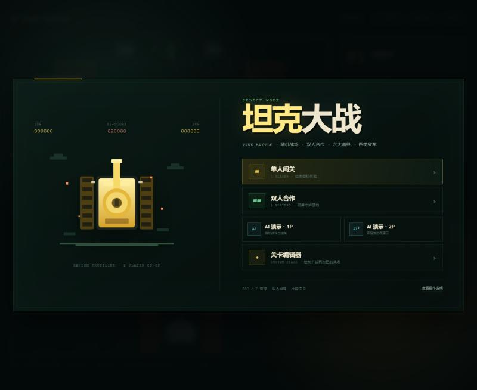
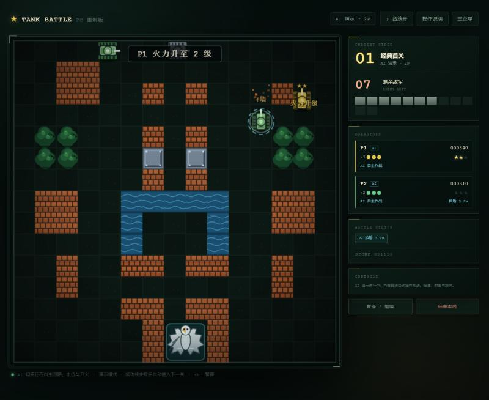
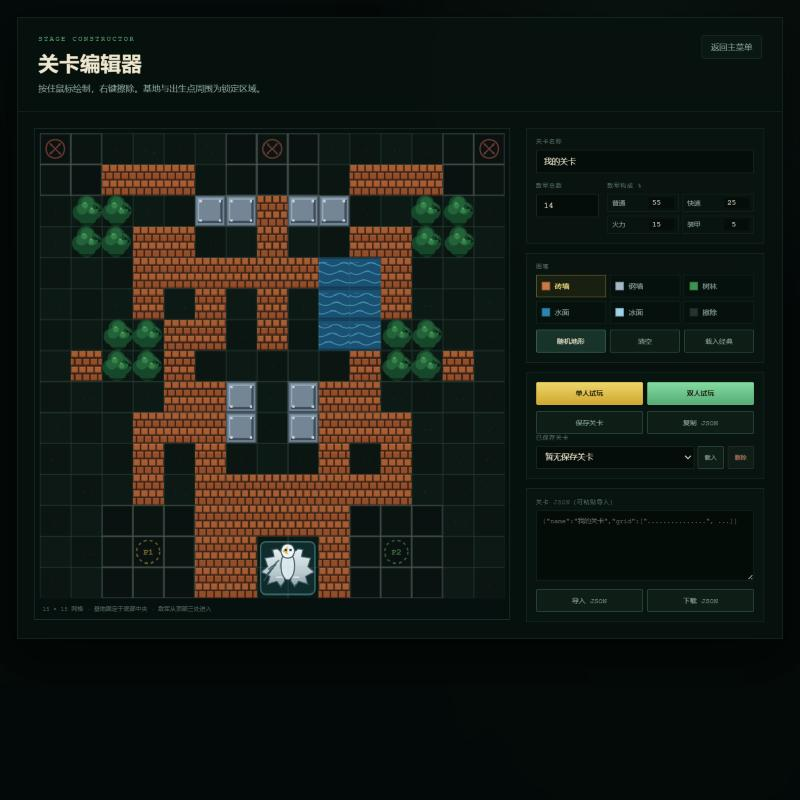

# 坦克大战 · FC 重制版

一个使用原生 HTML5 Canvas 编写的 FC 风格坦克大战游戏。无需构建工具，支持单人、本地双人、随机关卡、自定义关卡编辑器，以及由内置 AI 自动游玩的演示模式。



## 功能

- **单人 / 双人同屏**：支持键盘双人合作，同屏守护基地。
- **无限关卡**：清除当前关卡全部敌军后进入下一关，场地逐关随机生成。
- **随机道具**：火力升级、护盾、全屏爆破、时间冻结、钢铁基地、额外生命。
- **4 类敌军**：普通、快速、火力、装甲，拥有不同移动速度、射速、血量和分值。
- **关卡编辑器**：15×15 网格，支持砖墙、钢墙、树林、水面、冰面、擦除，以及敌军数量与构成配置。
- **自定义关卡存档**：本地保存/载入，支持 JSON 复制、导入与下载。
- **AI 演示模式**：可选择 1 辆或 2 辆 AI 坦克自动游玩，成功或失败后自动进入下一关。
- **纯前端运行**：无后端、无第三方运行时依赖、无构建步骤。

## 运行

项目使用 ES Modules，需要通过 HTTP 服务打开（不能直接双击 `index.html`）。

```bash
python -m http.server 8000
```

然后访问 [http://localhost:8000](http://localhost:8000)。

也可以使用 VS Code 的 Live Server、`npx http-server` 或任何静态文件服务器。

## 操作

| 操作 | P1 | P2 |
| --- | --- | --- |
| 移动 | `W A S D` | `↑ ← ↓ →` |
| 开火 | `J` | `空格` / `0` / `/` |
| 暂停 | `ESC` / `P` | `ESC` / `P` |

- 按住开火键可以连续射击，实际射速受火力等级和场上子弹数量限制。
- 自己发射的子弹同样会摧毁己方基地，开火前注意弹道。
- 音效需要首次键盘或鼠标交互后才能播放。

## 游戏规则

- 消灭本关全部敌军即可过关。
- 基地被任意子弹击毁，或全部玩家耗尽生命，本局失败。
- 击杀敌人有概率掉落道具，靠近即可拾取。
- 连续拾取星标可以提升火力，最高 3 级；高等级子弹可以击穿钢墙。
- 每关开始时玩家生命重置为 3 条；分数在连续关卡中累计。

### 道具

| 道具 | 效果 |
| --- | --- |
| ★ 星标 | 火力升级，最高 3 级 |
| 头盔 | 获得 8 秒无敌护盾 |
| 手雷 | 立即消灭场上所有敌军 |
| 时钟 | 冻结全部敌军 7 秒 |
| 铁铲 | 将基地外围砖墙替换为钢墙 18 秒 |
| 生命 | 额外增加 1 条命 |

### 敌军

| 类型 | 特点 | 速度 | 生命 | 基础射击间隔 | 分值 |
| --- | --- | --- | --- | --- | --- |
| 普通 | 均衡型 | 76 | 1 | 1.80s | 100 |
| 快速 | 移动速度快 | 122 | 1 | 1.65s | 200 |
| 火力 | 射击间隔短 | 84 | 1 | 1.00s | 300 |
| 装甲 | 4 点生命，需要多次命中 | 68 | 4 | 1.45s | 400 |

关卡推进时，敌军速度、射速和数量会略微提升，敌军构成也会逐渐偏向高等级单位。

## AI 演示

从主菜单选择「AI 演示 · 1P」或「AI 演示 · 2P」即可观看内置 AI 自动游玩。

AI 按照以下优先级行动：

1. **保护基地**：识别正在攻击基地、接近基地或弹道直指基地的敌人，优先拦截；基地遇到直接威胁时放弃个人躲弹，必要时移动到弹道前用身体或对射阻挡子弹。
2. **自身安全**：没有基地危机时优先躲避来袭子弹，在条件允许时对射。
3. **击杀敌人**：安全时进行目标追踪、清场与道具收集。

AI 演示会在每关成功或失败后自动继续下一关。详细设计见 [AI 设计说明](docs/AI_DESIGN.md)。

<p align="center">
  
</p>

## 关卡编辑器

从主菜单进入「关卡编辑器」：

- 15×15 网格，鼠标拖动绘制，右键擦除。
- 画笔支持砖墙、钢墙、树林、水面、冰面。
- 基地、玩家出生点和敌军出生点周围为锁定区域。
- 可配置敌军总数（4–30）以及普通/快速/火力/装甲的构成比例。
- 「随机地形」快速生成一张可玩的对称地图。
- 「单人试玩 / 双人试玩」立即试玩当前编辑结果。
- 支持保存到浏览器本地、载入已保存关卡、复制/导入 JSON、下载 JSON 文件。

<p align="center">
  
</p>

自定义关卡格式与完整示例见 [关卡格式说明](docs/LEVEL_FORMAT.md)。

## 项目结构

```text
.
├── index.html              # 页面结构、菜单、HUD、编辑器界面
├── css/style.css           # 整体视觉与响应式布局
├── js/
│   ├── config.js           # 网格、瓦片、敌人、道具、数值配置
│   ├── levels.js           # 内置关卡、随机关卡生成、关卡序列化
│   ├── entities.js         # 坦克、子弹、道具、基地实体
│   ├── ai.js               # AI 优先级、威胁评估、寻路与移动控制
│   ├── game.js             # 游戏状态机、碰撞、计分、关卡流程
│   ├── renderer.js         # Canvas 地图、坦克、特效与像素风渲染
│   ├── editor.js           # 关卡编辑器画布与绘制工具
│   ├── input.js            # 双人键盘输入
│   ├── audio.js            # WebAudio 合成音效
│   └── main.js             # UI 事件、HUD、游戏循环与状态衔接
└── docs/
    ├── AI_DESIGN.md
    ├── LEVEL_FORMAT.md
    └── screenshots/
```

## 技术说明

- 地图为 15×15 网格，每格 40px；坦克按连续坐标移动，但 AI 使用网格寻路。
- 世界碰撞与渲染均使用原生 Canvas，无外部图片资源；所有坦克、基地、道具和粒子均由代码绘制。
- 音效使用 WebAudio API 实时合成，无外部音频文件。
- 随机关卡会保证基地周边有防护结构，并使用 BFS 检查出生点、基地之间的静态连通性。
- 游戏状态包含进行中、暂停、过关、失败；AI 演示模式会自动推进状态。
- 关卡编辑器数据保存在浏览器 `localStorage`，不会上传服务器。

## 已知限制

- 需要键盘操作，暂未提供移动端触屏按钮。
- 必须通过 HTTP 服务运行；直接以 `file://` 打开时 ES Modules 会被浏览器阻止。
- AI 是规则驱动的行为树/寻路实现，不包含学习能力；基地告急时允许主动牺牲坦克。
- 当前仓库未附带开源许可证；如需 MIT、Apache-2.0 等授权方式，请自行添加 `LICENSE` 文件。

## 截图

| 主菜单 | AI 双人演示 |
| --- | --- |
|  |  |

| 关卡编辑器 |
| --- |
|  |
